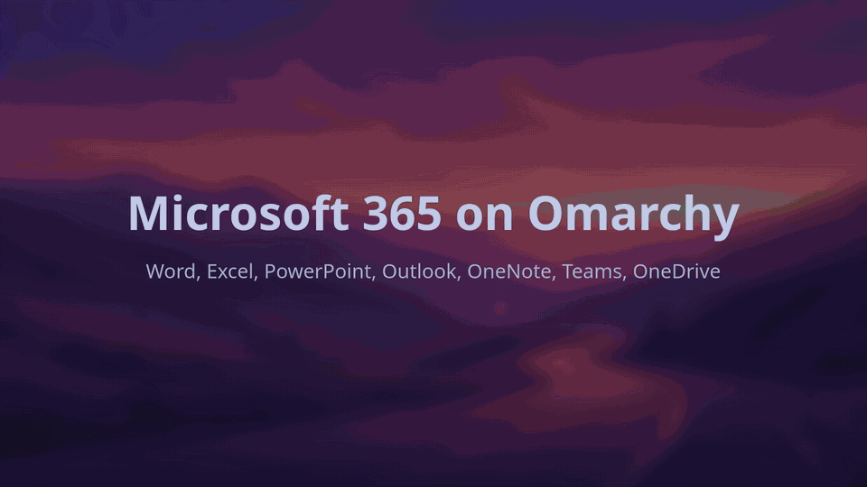

# omarchohard

Real Microsoft Office desktop apps on [Omarchy](https://omarchy.org) (Arch
Linux + Hyprland). Word, Excel, PowerPoint, Outlook and OneNote are the
Windows programs themselves, each in its own window next to your Linux apps.
Add-ins and macros work, Office updates itself, and your `.docx`, `.xlsx`
and `.pptx` files open from Files.

```sh
curl -fsSL https://raw.githubusercontent.com/baney75/omarchohard/main/install.sh | bash
```

Run from a terminal, that one line installs the CLI and starts a short guided
setup. Its first question is which Office you want:

- **Native Office** (experimental): Microsoft 365's desktop apps on Linux
  itself under Wine, no VM. About 6 minutes from Microsoft on the first
  device, and under a minute on every other device, which copies the first
  one's install. Needs an x86_64 machine, 8 GB of memory and 8 GB of disk.
- **Desktop Office**: the real Windows apps, with add-ins, macros, printing
  to your Linux printers, offline use and Office's own updates. A one-time
  install of about 20 minutes; needs KVM, 16 GB of memory and about 80 GB of
  disk.
- **Web apps**: Microsoft's web apps as app windows. Ready in about two
  minutes and light on memory.

Setup recommends native Office, then desktop Office, only when your machine
can run it, and says why when it cannot. Teams is a web app either way.

## How desktop Office works

Desktop Office runs in a Windows virtual machine you never see.
[dockur/windows](https://github.com/dockur/windows) installs Windows in a
container with KVM, and [WinApps](https://github.com/winapps-org/winapps)
shows each Office app as its own Linux window through FreeRDP RemoteApp.
omarchohard sets both up, installs Office from Microsoft's servers, adds the
apps to the launcher and the file handlers, and reports progress until Office
is ready.

No tool converts a Windows `.exe` into a Linux program; the Windows build has
to run on Windows. Wine and CrossOver run some Windows programs on Linux
directly, and CrossOver shipped Office fixes for years
([CrossOver changelog](https://www.codeweavers.com/crossover/changelog)), but
stock Wine tops out at Office 2016 for the core apps, and CrossOver 26
no longer officially supports Office
([a comparison of the Linux options](https://gist.github.com/eylenburg/38e5da371b7fedc0662198efc66be57b)).
[wine-altars](https://github.com/Altars3668/wine-altars), a Wine fork, runs
Microsoft 365's own installer and apps; that is the
[native tier](#native-office). A VM costs memory and disk, and in return
Office behaves as it does on a Windows PC.

Desktop Office is experimental: an end-to-end run is in progress. Word and
Excel have opened as their own windows on one machine; the full install from
`omarchohard setup` is untested live. See [Desktop Office](#desktop-office)
and [docs/desktop-tier.md](docs/desktop-tier.md).

## The web apps



Recorded in a clean Arch container under Hyprland: the one-line install,
`omarchohard doctor`, then four web apps opening as their own windows.

- Each app is a Chromium `--app` window in your default Chromium-family
  browser profile, so one sign-in covers every app. They need a network
  connection and a Microsoft account (personal, school or work). Features
  only desktop Office has (VBA macros, COM and VSTO add-ins, advanced mail
  merge) are not there; Office Add-ins from the store do work (see
  [Add-ins](#add-ins-and-extensions)).
- Desktop entries, icons, file handlers and URL handlers (`mailto`, `msteams`,
  `ms-word`, `ms-excel`, `ms-powerpoint`, `onenote`), registered the
  freedesktop way and fully reversible.
- Launch-or-focus through `hyprctl`: opening Word when Word is open raises
  that window.
- OneDrive on disk, so files open from the Files app, through an rclone mount
  (default) or the abraunegg `onedrive` client.
- Sharing from the terminal or from Files (right-click, Scripts): open a
  document to share it by name, or copy a OneDrive link.
- A guided setup for people (`omarchohard setup`, also in the launcher as
  Microsoft 365 Setup) and flags plus JSON for agents (`probe`, `optimize`).

## What it is not

- **Not a Linux port of Office.** Microsoft ships no Linux desktop Office.
  Desktop Office here is the Windows build, in a Windows VM or under Wine;
  the web apps are the ones Microsoft hosts at `*.cloud.microsoft`.
- **Not a browser and not a sync engine.** It drives the browser you have and
  the OneDrive client you pick.
- **Not affiliated with Microsoft.** See the trademark notice at the end.

## Quick start

```sh
curl -fsSL https://raw.githubusercontent.com/baney75/omarchohard/main/install.sh | bash
```

From a terminal, the installer goes straight into `omarchohard setup`, six
steps that each take one keypress:

1. **Office.** Native Office, desktop Office or the web apps, as above.
   Native and desktop Office install at the end, after the other answers,
   and the web apps are set up too, for Teams. For native Office, setup also
   asks which Microsoft 365 you have.
2. **Browser.** Your default Chromium-family browser is picked first. If you
   have none, setup offers to install Chromium.
3. **Account.** Your Microsoft email, optional; it fills in the sign-in page
   and the OneDrive address.
4. **Apps and files.** Pick which apps to install (all are checked; space
   toggles), which files open in Office (Microsoft formats only, or other
   formats too), and whether `mailto:` links open Outlook.
5. **Sign in.** Opens Microsoft's own sign-in page once. Skip it if you are
   already signed in in that browser.
6. **OneDrive.** Files on demand with rclone (recommended), a full offline
   copy, or not now.

It ends by running `omarchohard doctor`. Run `omarchohard setup` again at any
time to change an answer.

**From the launcher.** Install adds **Microsoft 365 Setup** to the apps menu
(Super + Alt + Space). It opens the same setup in a floating terminal, so
nobody has to type a command after the one-line install.

**Without questions** (scripts and agents):

```sh
curl -fsSL https://raw.githubusercontent.com/baney75/omarchohard/main/install.sh | bash -s -- --yes
# or pick the answers:
omarchohard setup --yes --browser chromium --apps word,excel,powerpoint,teams --onedrive none
# native Office, without questions:
omarchohard setup --yes --tier native --plan school
# desktop Office, without questions:
omarchohard setup --yes --tier desktop
```

`--yes` without `--tier` sets up the web apps only, so a script never starts
a Microsoft download unasked.

[docs/agents.md](docs/agents.md) covers `probe --json`, `optimize` and what
still needs a person.

You need a Chromium-family browser (Chromium, Chrome, Edge, Brave, Helium or
Vivaldi). If you have none: `omarchy pkg add chromium`. Firefox cannot open
app windows; see [Firefox as default browser](docs/troubleshooting.md#firefox-as-default-browser).

The steps one at a time:

```sh
omarchohard install            # launchers, icons, file handlers
omarchohard login              # sign in once (school or work SSO page if you have one)
omarchohard onedrive setup     # OneDrive on disk so files open from Files
omarchohard doctor             # check everything; exits 1 if a required check fails
```

| `install` option | Effect |
| --- | --- |
| `--apps LIST` | Install only these apps, such as `word,excel,teams` (`all` by default) |
| `--isolated` | Use a dedicated browser profile instead of your everyday one (separate sign-in) |
| `--no-mail` | Leave your current `mailto:` handler alone |
| `--prewarm` | Turn on the prewarm service (isolated profile only) |

### Choosing apps

Add or remove one app at any time; a removed app hands its file types back to
whatever had them before:

```sh
omarchohard add teams
omarchohard remove onenote outlook
```

Microsoft 365 home always stays, as it is the way to every app and to Copilot.

### Choosing files

Microsoft Office files (`.docx`, `.xlsx`, `.pptx` and their older, macro and
template forms) open from Files in Office. Other formats keep the app they
had unless you add them:

```sh
omarchohard files              # show the choice
omarchohard files odt,csv      # also .odt in Word and .csv in Excel
omarchohard files all          # also .odt .ods .odp .rtf .csv
omarchohard files microsoft    # back to Microsoft formats only
```

## Supported apps

| App | Web address | Files and links it opens | Desktop tier |
| --- | --- | --- | --- |
| Word | `word.cloud.microsoft` | `.docx` `.doc` `.docm` `.dot` `.dotx` `.dotm`, `ms-word:` links; `.odt` `.rtf` if chosen | Yes |
| Excel | `excel.cloud.microsoft` | `.xlsx` `.xls` `.xlsm` `.xlsb` `.xlt` `.xltx` `.xltm`, `ms-excel:` links; `.ods` `.csv` if chosen | Yes |
| PowerPoint | `powerpoint.cloud.microsoft` | `.pptx` `.ppt` `.pptm` `.pps` `.ppsx` `.ppsm` `.pot` `.potx` `.potm`, `ms-powerpoint:` links; `.odp` if chosen | Yes |
| Outlook | `outlook.cloud.microsoft/mail/` | `mailto:` links (skipped with `--no-mail`) | Yes |
| OneNote | `onenote.cloud.microsoft` | `onenote:` links | Yes |
| Teams | `teams.cloud.microsoft` | `msteams:` links (meetings, chats) | No, web only |
| OneDrive | `onedrive.cloud.microsoft` | None; files come to disk through `omarchohard onedrive setup` | No, web only |
| Microsoft 365 | `m365.cloud.microsoft` | None; the home page and Copilot | No, web only |

Launch any of them from the launcher, or with `omarchohard launch word`
(`excel`, `powerpoint`, `outlook`, `onenote`, `teams`, `onedrive`, `m365`).

**Teams** installs like the rest (`omarchohard add teams` if you left it out)
and runs the new Teams web app, the same one Microsoft ships as the Linux
"Teams for the web" experience. The browser asks once for the camera and
microphone. Screen sharing goes through the desktop portal Omarchy ships
(xdg-desktop-portal-hyprland), which shows a picker for a screen or a window.
Meeting links from mail or a calendar open in the Teams window. Calls, screen
sharing and notifications are untested live.

## How files open

The web apps edit files that live in OneDrive, so where a file sits decides
what happens:

- **Inside your OneDrive folder** (`~/OneDrive` by default): the file opens in
  place at its OneDrive address. Edits save to that file, and the sync client
  brings them back to disk.
- **Anywhere else** (Downloads, a USB stick): omarchohard copies the file into
  `OneDrive/Omarchohard/`, waits up to 60 seconds for the upload, and opens
  the copy. Your original is never changed. A different file with the same
  name gets a numbered copy, such as `Report (1).docx`.
- **Before OneDrive is set up**: the app opens and a notification says to run
  `omarchohard onedrive setup`.
- **With desktop Office** (`omarchohard desktop prefer on`, which setup turns
  on): local files open directly in desktop Office (files under your home
  folder or `/run/media`), with no copy and no OneDrive needed.

In-place opening needs your OneDrive web address, the part up to and
including `/Documents`, for example
`https://school-my.sharepoint.com/personal/you_school_edu/Documents`.
`omarchohard onedrive setup` asks for it; set it later with
`omarchohard onedrive web-root URL`.

## How sync works

`omarchohard onedrive setup` sets up one of two clients as a systemd user
service, `omarchohard-onedrive.service`:

- **rclone (default)**: a FUSE mount at `~/OneDrive` with a full local cache
  (`--vfs-cache-mode full`, up to 20 GB, kept for a year). Every file is
  listed at once; a file downloads the first time you open it and opens from
  cache after that. Saves upload 2 seconds after the file closes, and changes
  made on the web show up within 30 seconds.
- **abraunegg `onedrive`** (`--client abraunegg`): a complete two-way copy on
  disk, for full offline use, kept current by `onedrive --monitor`.

The web apps save straight to OneDrive, so either client brings their edits
back down to the same folder. `omarchohard onedrive status` shows the client,
folder, service state, web address and, for rclone, the live upload queue
("up to date", or how many files are uploading). `omarchohard onedrive sync`
pulls changes from other devices now and waits until every local save has
uploaded, which is handy before you shut the lid.

The rclone mount answers status questions on a private socket in your runtime
folder (`$XDG_RUNTIME_DIR`, mode 0700), so nothing listens on the network.

## Sharing

```sh
omarchohard share Report.docx               # opens it in Word; choose Share to send it by name
omarchohard share --link Photo.jpg          # copies a view link to the clipboard
omarchohard share --link --edit Budget.xlsx # an edit link
```

- An Office document opens in its app, where **Share** sends it to people by
  name with Microsoft's own sharing dialog.
- `--link` asks OneDrive for a link, prints it and copies it with `wl-copy`.
  School and work accounts get a link for people in the organization, since
  many tenants turn off links for anyone; personal accounts get a link anyone
  can open. Override with `--org` or `--anyone`. When anyone links are off,
  an anyone link falls back to the organization; a failed organization link
  stops with an error and never becomes one anyone can open.
- A file outside OneDrive is copied into `OneDrive/Omarchohard/` first, as
  when opening one.
- In Files (Nautilus), right-click a file, then **Scripts**: **Share with
  OneDrive**, **Copy OneDrive link** and **Open in Microsoft 365**. They are
  added only when Nautilus is installed and removed by `uninstall`.

## Add-ins and extensions

- **Office Add-ins** (the store under Home > Add-ins, such as Grammarly,
  Zotero or Wikipedia) run in the web apps. They follow your Microsoft
  account, so one you added on Windows shows up here too.
  `omarchohard addins word` opens Word and says where to find them.
- **Browser extensions** you have in your everyday Chromium profile (password
  managers, Grammarly for Chrome, dark readers) work in every app window with
  the default shared profile. With `--isolated`, install them in that profile.
- **COM, VSTO and VBA add-ins** are Windows programs and need desktop Office.
  There, `omarchohard desktop run Tool.xll` (or right-click, Open With, Open
  in Windows) hands an add-in file to Windows, which installs it into Office.


## Sign-in

Using both tiers takes two sign-ins in all: one in the browser for every web
app, and one in Office for every desktop app.

- **Desktop Office** signs in once, in Office's own window: an unlicensed
  Microsoft 365 opens "Sign in to get started", and "Sign in or create
  account" opens Microsoft's sign-in page as its own window on your desktop.
  Word, Excel, PowerPoint, Outlook and OneNote run as the same Windows user,
  so they share that one account through Windows' account manager, and the
  sign-in activates Microsoft 365 for all of them. `desktop slim` leaves the
  sign-in alone.
- **Stay signed in to all your apps.** After a school or work sign-in,
  Windows asks this. OK registers the VM with your organization so the
  other Microsoft apps in Windows reuse the sign-in too. Untick "Allow my
  organization to manage my device" first unless you want your school or
  employer to manage the VM; the sign-in works either way.
- **The web apps** sign in through your default browser. Every app uses single
  sign-on (SSO) in your default browser profile. Sign in
  once with `omarchohard login` (or in any app window) and every app is signed
  in. School and work accounts go through their own sign-in page.
- `omarchohard login --email you@school.edu` fills in the address for you.
- `--isolated` keeps Microsoft 365 in its own profile, apart from your
  everyday browsing; you sign in once more there.
- omarchohard never reads tokens, cookies, passwords or auth files. rclone and
  the `onedrive` client run their own Microsoft sign-in and keep their own
  tokens. If your school blocks that sign-in, see
  [OneDrive sign-in](docs/troubleshooting.md#onedrive-sign-in).

## Release channels

| Channel | What it is | Version example | Install with |
| --- | --- | --- | --- |
| stable | The newest tagged release | `0.3.0` | `curl -fsSL .../install.sh \| bash` |
| nightly | A build of `main` at 06:00 UTC that passed the full test suite; skipped when `main` has not changed | `0.1.0-nightly.20261111+636ab6e` | `... \| bash -s -- --channel nightly` |
| dev | Every push to `main` that passed CI | `0.1.0-dev.42+636ab6e` | `... \| bash -s -- --channel dev` |

Switch at any time with `omarchohard channel nightly` (or `dev`, `stable`);
`omarchohard update` updates within the channel. Every download is checked
against its sha256 before anything changes, and a failed update leaves the
old version and channel in place. Details: [docs/channels.md](docs/channels.md).

Arch packages: `packaging/arch` has PKGBUILDs for `omarchohard` (stable) and
`omarchohard-git` (newest commit). They are not on the AUR yet; build them
with `makepkg -si`. A package-managed install updates through pacman, not
`omarchohard update`.

## Performance

Time from the launch command to Hyprland mapping the app window, measured on
an Intel i9-14900HX laptop (Omarchy, Hyprland 0.56.2, Chromium 152, 32 threads). This is window
time, not page load; page load depends on your network and on Microsoft.

| Case | Median | Runs |
| --- | --- | --- |
| First launch ever, new profile | 757 ms | 678, 835 ms |
| Cold, browser not running | 404 ms | 404, 401, 430 ms |
| Warm, another omarchohard app already open | 231 ms | 200, 261 ms |
| Prewarm on (resident windowless browser, about 215 MB RSS) | 230 ms | 230, 238, 221 ms |

With two runs, the median is the midpoint of the two.

omarchohard's own work before it hands off to the browser, best of 15 runs on
the same machine:

| Step | Time |
| --- | --- |
| `omarchohard open --app word` | 18 ms |
| Double-click a `.docx` (`omarchohard open file.docx`) | 24 ms |

Prewarm (`omarchohard prewarm on`) keeps one windowless browser running in
the isolated profile. With your default profile it is not needed: when your
browser is open, launches are already warm.

## Native Office

Experimental. Word, Excel, PowerPoint, Outlook and OneNote from Microsoft 365
run on Linux itself, with no VM, under
[wine-altars](https://github.com/Altars3668/wine-altars) (v11.19-altars.1), a
Wine fork that runs Office's own Click-to-Run installer. omarchohard downloads
the fork's release (110 MB, checked against its pinned SHA256 before anything
is extracted), installs Office into a Wine prefix in
`~/.local/share/omarchohard/native`, and opens Office files there.

```sh
omarchohard native check                                   # x86_64, Hyprland, 8 GB of memory, 8 GB free disk
omarchohard setup --tier native --plan school              # the first device: Office from Microsoft
omarchohard setup --tier native --yes --from ssh:laptop    # every other device: a copy of the first
omarchohard native signin --remote                         # sign in from another device, through a one-time link
omarchohard native status                                  # --json for scripts
omarchohard native uninstall
```

### Who it is for

| Your Microsoft 365 | What to pass | Office it installs | Sign-in done by |
| --- | --- | --- | --- |
| Personal or Family | `--plan personal` or `--plan family` (the default) | O365HomePremRetail | You, with your Microsoft account |
| School, with the desktop apps | `--plan school` | O365ProPlusRetail | Each student or staff member, with the school account |
| Work, small business (Business Standard, Business Premium, Apps for business) | `--plan business` | O365BusinessRetail | Each employee, with the work account |
| Work, large organization (E3, E5, Apps for enterprise) | `--plan enterprise` | O365ProPlusRetail | Each employee, with the work account |

Plans without the desktop apps, such as Business Basic, have the web apps
only. Interactive setup asks which plan you have; `--yes` without `--plan`
installs Personal and Family and says so. `--shared-computer` turns on
[shared computer activation](https://learn.microsoft.com/en-us/microsoft-365-apps/licensing-activation/overview-shared-computer-activation)
for a computer several people use; Microsoft supports it for school and
enterprise plans, so omarchohard refuses it for the others. Only the
O365ProPlusRetail install has been run under wine-altars so far.

### How it behaves

Measured on Parish1 (Omarchy, Hyprland, btrfs), 2026-11-13:

- **The first device** installs from Microsoft: the Wine prefix (48 s),
  Microsoft Edge WebView2 for the sign-in window (94 s) and Office from a
  local copy (2 min 36 s to 2 min 49 s), with Office's 3.4 GB download
  running at the same time as the first two. About 6 minutes from these
  steps; the whole fresh install through omarchohard is untested live.
  Then it starts Word once on a hidden screen (Xvfb, when installed) to
  absorb the fork's one-time first-start crash box, and writes the **seed**:
  the prefix before anyone signed in, 2.9 GB.
- **Every other device** copies a seed instead: 21 s from a seed file and
  32 s from a `native seed serve` link on the tailnet, each with the Wine
  download. Between two machines the network sets the pace; 2.9 GB at
  100 MB/s is about 30 s. `--from` takes a seed file (a USB stick works),
  `ssh:HOST`, an `https://` link, or a plain `http://` link on a private
  address together with `--sha256`, which is checked before the seed is
  used or kept. A seed for another plan's Office is refused.
- **Opening.** Word's first window came up 5.7 s after a seeded install and
  1.0 s when Wine was already running. Wine stays up for 10 minutes after
  the last Office app closes. The apps are X11 windows through Xwayland.
- **Fonts.** Office's interface uses Segoe UI, which is Windows' own.
  omarchohard puts Microsoft's open-source stand-in,
  [Selawik](https://github.com/microsoft/Selawik) (SIL Open Font License
  1.1, shipped in `share/omarchohard/fonts/selawik`), into the prefix and
  maps Segoe UI to it, so Office's text has its intended shapes.
- **Disk.** The prefix takes 6.6 GB, or 3.1 GB on btrfs, where omarchohard
  turns on zstd compression for it, plus the 2.9 GB seed.
- **Sign-in.** Once, in Word's own window; it covers every app. `native
  signin --remote` is for a person at another device, a phone included:
  Word opens on a hidden screen, and a page on this device's Tailscale name
  (or with `--lan` its home network address, never every address) shows
  only Office's sign-in window, at its real size or smaller, in light or
  dark mode. The link carries a one-time password after `#`, which browsers
  never send to the server, and the page takes it out of the address bar.
  It is printed as `Sign in here: http://laptop.example.ts.net:6080/#pw=...`
  and sent as a notification. It stops when Word closes or after 30
  minutes. Office has no
  documented setting that fills in the sign-in address, so `--email` only
  names the account in setup's messages.
- **Updates.** Office does not update itself in this tier; a newer Office
  comes from a new fresh install and its seed.
- **Organizations.** A school or employer can require a managed Windows
  device for its accounts. Office then shows error AADSTS53000, 53001 or
  53003; use the web apps or ask IT
  ([troubleshooting](docs/troubleshooting.md#native-office-aadsts53000-53001-or-53003)).

**Seeds hold Microsoft's Office binaries.** Move them only between your own
devices, or your organization's, and never publish one. The license comes
from each person's own sign-in. `native seed` only ever sends the seed
written before sign-in; it never packs the live prefix, so a signed-in
Office never leaves the device. omarchohard never reads Office's identity or
token stores.

Setting up many devices, by hand or with agents:
[docs/agents.md](docs/agents.md#set-up-many-devices).

## Desktop Office

Experimental: an end-to-end run is in progress. Word and Excel have opened as
RemoteApp windows on one machine; the full install from `omarchohard setup`
is untested live.

```sh
omarchohard desktop check            # KVM, Docker or Podman, FreeRDP 3, memory, disk
omarchohard setup --tier desktop     # or: omarchohard desktop install --wait
omarchohard desktop status           # where the install is; --json for scripts
omarchohard desktop run Setup.exe    # open any file in Windows: add-ins, installers, documents
omarchohard desktop update           # update Office and Windows now
```

- **Install.** `desktop install --wait` prints each step (downloading Windows,
  installing Windows, installing Office) until Office is ready, then adds
  Word, Excel, PowerPoint, Outlook and OneNote to the launcher and sends local
  Office files to them. Ctrl-C stops only the watching; `omarchohard desktop
  wait` picks it up again.
- **Windows.** Each app opens in its own window, and opening it again raises
  that window, found by its title. On Omarchy's Lua Hyprland config,
  omarchohard adds a few window rules (`~/.config/hypr/omarchohard.lua`, loaded
  by one line in `hyprland.lua`): documents stay opaque, and the hidden
  RemoteApp marker window stays out of sight. Teams stays a web app.
- **Add-ins and macros.** `desktop run` opens any file under your home
  folder or `/run/media` with its Windows program, so an `.xll`, `.xlam`,
  `.ppam`, `.dotm` or `.vsto` add-in installs into Office. Macros follow
  Office's own Trust Center settings, which omarchohard does not change: a
  `.docm` opened from Files showed Word's "Macros have been disabled" bar
  with **Enable Content**, and its `AutoOpen` macro did not run. With
  macros allowed in Word's Trust Center, the same macro ran 2 seconds
  after the document opened.
- **Printing.** Your Linux (CUPS) printers show in Windows as
  `NAME (redirected N)`, and Office prints to them. On the test VM, pages
  printed from Word and from PowerShell reached a CUPS queue.
- **Clipboard.** Text copied in Windows pastes into Linux apps within about
  2 seconds. Text copied in an X11 app reached Windows. Text copied in a
  Wayland app did not reach Windows in the nested Hyprland test session;
  this is untested on a real Omarchy desktop.
- **Updates.** Office updates itself in the background. `desktop update`
  asks for an update now and starts a Windows Update scan;
  `--channel current|monthly|semi-annual` and `--to VERSION` choose what to
  update to. `omarchohard doctor` shows the Office version and channel.
- **Sign-in.** Microsoft 365 activates when you sign in once in Office's own
  sign-in window ("Sign in to get started with Word"), and that one sign-in
  covers every Office app ([Sign-in](#sign-in)). Until then Office
  opens in reduced functionality mode: you can view and print,
  not edit. A bought Office 2021 or 2024 key goes in with
  `omarchohard desktop activate`, and a Windows key with
  `omarchohard desktop activate --windows`. Keys are read from a hidden
  prompt or a key file, never from the command line. The default Windows is
  the free 90-day evaluation; `--windows 11` uses your own license.

It needs KVM, Docker or Podman, FreeRDP 3, at least 16 GiB of RAM (6 GiB free
when you start it) and about 80 GB of disk.

One hidden RDP connection stays open with a small agent in Windows, so a
launch is a request file, not a new connection. Measured on one machine
(2026-11-12: dockur 6.06, Windows 11 Enterprise evaluation, Microsoft 365
Apps, FreeRDP 3, Hyprland 0.57): a Word file opened in 1.2 s through the
agent against 2.1 s through WinApps alone, and in 0.24 to 0.33 s once the
agent keeps Word warm. The VM used 3.4 GiB of memory. On 2026-11-13 a new
VM took 20 minutes from `desktop install` to Office ready, 8.6 of them
downloading Windows, and 12 GB of disk once the first boot's cleanup and
the disk compression, which both run by themselves, were done.
Details and the full table are in [docs/desktop-tier.md](docs/desktop-tier.md).

 The Windows VM can read your whole
home folder; read the warning in [docs/desktop-tier.md](docs/desktop-tier.md)
first.

## Uninstall

```sh
omarchohard uninstall           # remove launchers, icons and handlers; restore your previous defaults
omarchohard uninstall --purge   # also remove config, state, the OneDrive service and the isolated profile
rm -rf ~/.local/share/omarchohard ~/.local/bin/omarchohard   # remove the CLI itself
```

Files in your OneDrive folder stay where they are. A pacman install comes out
with `sudo pacman -R omarchohard` after `omarchohard uninstall`.

## Troubleshooting

`omarchohard doctor` names the failing piece and the command that fixes it.
For sign-in blocks, camera and microphone in Teams, Hyprland window rules,
Firefox and wrong accounts, see [docs/troubleshooting.md](docs/troubleshooting.md).

## Status

**Verified** (checks that could fail and passed, in a clean Arch Linux
container; see `make lint test container`):

- 127 bats tests: install twice is idempotent; doctor passes after install and
  fails on a removed launcher, a removed icon, a reassigned handler and a
  non-executable Exec path; `xdg-open` sends the `.docx`, `.xlsx` and `.pptx`
  fixtures to Word, Excel and PowerPoint; `mailto`, `msteams` and `ms-word`
  mapping; OneDrive address encoding (space, `#`, `é`); outside files copied
  with the original untouched; uninstall restores `mimeapps.list`; the config
  is never executed; channel switching and checksum refusal; `setup --yes`
  and setup with typed answers; `install --apps`, `add` and `remove` handing
  file types back; `probe --json` is valid JSON; `optimize` changes nothing
  without `--apply`; share link scope and copy-in; the Files scripts; and
  `onedrive sync` against a stub rclone socket; and, for desktop Office with
  stub Docker and FreeRDP: the no-COW storage folder on btrfs, install phases
  read from the VM log and `office-status.json`, `install --wait` through
  Ctrl-C, launch-or-focus by window title, `desktop run` path checks with
  the password on stdin and never on the command line, the update allowlists,
  the doctor rows, the first-boot script (hidden task windows, the console
  signed out after Office), the Hyprland rules added and removed by one line,
  and Kerberos off for the VM connection.
- The one-line installer over HTTP for stable, nightly and dev, then install,
  doctor, file handler defaults, switching between all three channels, and
  uninstall.
- A launch smoke under headless sway with real Chromium 156: all 7 apps map a
  window with the expected app id (about 350 ms for the first, 150 ms for
  each after it, in the container).
- The `omarchohard-git` and `omarchohard` PKGBUILDs build with makepkg,
  install with `pacman -U`, and pass `omarchohard install` and `doctor` in
  the `/usr` layout.

**Untested live:** a real Microsoft sign-in, the OneDrive mount with a real
account, an in-place edit round trip, a real share link, the setup window from
the launcher, the Files scripts in Nautilus, Teams calls, screen sharing and
notifications, launch-or-focus under
Hyprland, the prewarm service under systemd, and desktop Office end to end
from `omarchohard setup` (the first-boot script's sign-out and hidden task
windows, FreeRDP 3 reading the password from stdin, the Hyprland rules in a
live session, the PowerShell scripts in the VM). The
launch times above were measured by hand on that laptop.

## License and trademarks

MIT; see [LICENSE](LICENSE).

omarchohard is an independent project. It is not affiliated with, endorsed by
or sponsored by Microsoft Corporation. Microsoft, Microsoft 365, Word, Excel,
PowerPoint, Outlook, OneNote, Teams, OneDrive and Windows are trademarks of
the Microsoft group of companies. The app icons are plain letter tiles drawn
for this project, used only to tell the apps apart.
